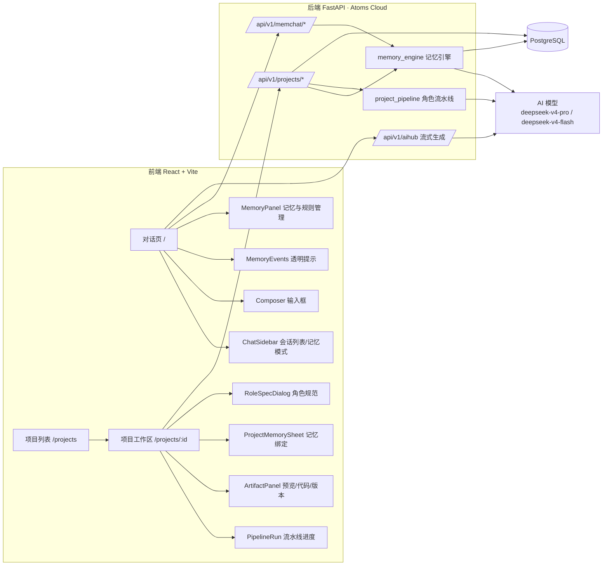
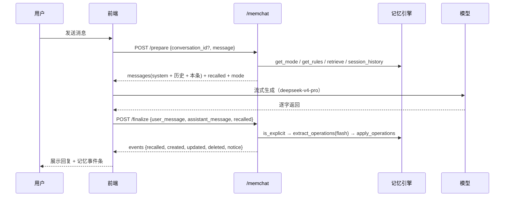
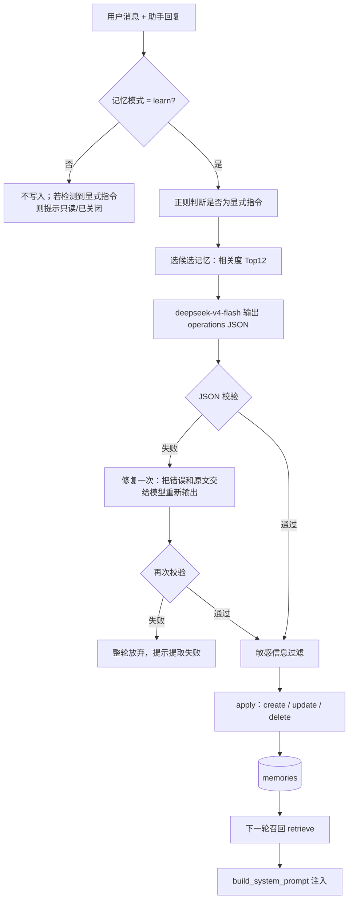
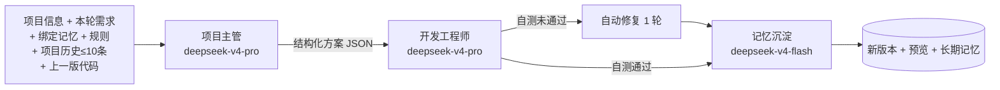
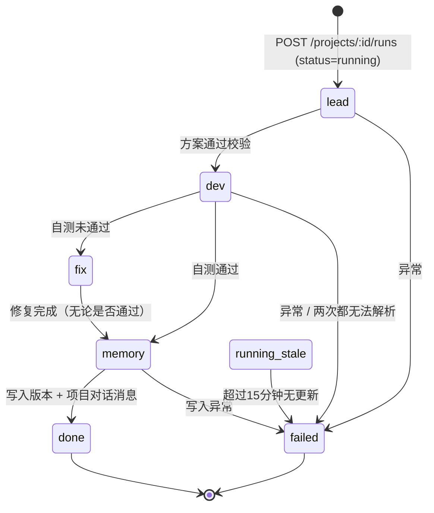
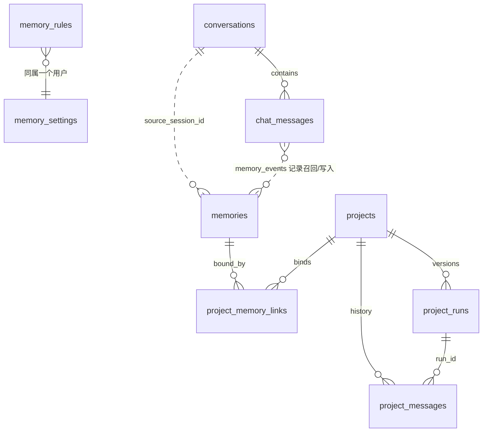

# Atoms Demo 系统功能设计说明

> 本文档依据当前代码实现编写（后端 `backend/services/memory_engine.py`、`backend/services/project_pipeline.py`、`backend/routers/memchat.py`、`backend/routers/project_workspace.py`，前端 `frontend/src/pages`、`frontend/src/components`）。文中标注 **⚠️ 局限 / 未验证** 的内容，表示当前实现存在已知限制，或尚未完成端到端验证。

## 目录

1. 系统概览
2. 对话模块
3. 记忆系统（核心）
4. 项目板块（核心）
5. 数据模型
6. 使用指南与常见问题
7. 设计取舍与扩展方向
8. 已知局限汇总

---

## 1. 系统概览

### 1.1 定位

这是一个 **带记忆内核的 Atoms Demo**，由两大板块组成：

- **对话（记住你）**：普通的 AI 对话，外加“规则层 / 会话层 / 长期记忆”三层记忆。用户的偏好和背景会被提炼成结构化记忆，新开对话时也能召回；每一次记忆的读写都会在界面上展示，并且可以修改。
- **项目工作区**：用户填写项目目标和验收标准，并绑定记忆，由“项目主管 → 开发工程师（含自测与一轮自动修复）→ 记忆沉淀”这条流水线生成一个可预览的单页网页应用。每轮迭代产生一个新版本。

两个板块共用同一个长期记忆库：对话里沉淀的记忆可以绑定到项目，项目迭代得出的结论也会回流到长期记忆库。

### 1.2 整体架构

### 1.3 主要模块与模型

| 模块 | 代码位置 | 作用 | 使用模型 |
|---|---|---|---|
| 对话回复 | `routers/memchat.py` 的 `/prepare` 加前端流式调用 | 组装上下文并流式生成回复 | `deepseek-v4-pro` |
| 记忆引擎 | `services/memory_engine.py` | 规则 / 召回 / 抽取 / 写入 | 抽取用 `deepseek-v4-flash` |
| 项目主管 | `services/project_pipeline.py` 的 `run_lead` | 拆解任务、制定验收要点 | `deepseek-v4-pro` |
| 开发工程师 | `services/project_pipeline.py` 的 `run_developer` | 生成代码、自测、修复一轮 | `deepseek-v4-pro` |
| 记忆沉淀 | `routers/project_workspace.py` 的 `_sediment_memories` | 把项目结论写入长期记忆 | `deepseek-v4-flash` |

所有 AI 调用都在后端经平台 AI 能力（AIHub）完成，前端不持有任何模型密钥。所有业务数据都按 `user_id` 隔离，每个接口都会校验数据归属。

---

## 2. 对话模块

### 2.1 使用方式

1. 登录后进入首页 `/`。左侧是会话列表，以及“记忆模式”“记忆管理”入口和项目工作区入口。
2. 在输入框发送消息。首页提供了几条示例提示，例如“记住：我是前端工程师，主要用 React 和 TypeScript”“你记得关于我的哪些信息？”。
3. 每轮对话的状态依次为：**正在检索记忆… → 已召回 N 条记忆，正在思考… → 流式输出 → 正在提炼记忆… → 完成**。
4. 助手消息下方会出现 **记忆事件条**，列出本轮召回、新建、更新、删除了哪些记忆，以及提示信息。

### 2.2 新建对话

- 点击侧边栏的“新建对话”，会清空当前会话。发送第一条消息时，后端会自动创建会话，标题取消息前 24 个字。
- 新对话**不会**带上旧会话的消息（会话层隔离），但**会**召回长期记忆，也会注入全局规则。这就是“新对话也会用上”的含义。
- 删除对话会连同其消息一起删除，**长期记忆不受影响**（界面提示“对话已删除（长期记忆不受影响）”）。

### 2.3 单轮对话的处理流程

设计要点：回复环节和记忆写入环节**拆成两次请求**。回复走流式输出，首字延迟低；记忆抽取在回复结束后进行，抽取失败也不会影响已经给出的回复（失败时提示“记忆提取暂时失败，本轮未写入记忆”）。

---

## 3. 记忆系统（核心）

### 3.1 三层记忆与生命周期

| 层级 | 存储 | 由谁产生 | 作用范围 | 注入方式 | 生命周期 |
|---|---|---|---|---|---|
| **规则层**（Steering） | `memory_rules` | 用户在“记忆管理 → 规则”中手动添加 | 全局，所有对话和项目 | 每次都注入系统提示词，优先级最高（“必须遵守”） | 用户启用、停用或删除（删除为物理删除） |
| **会话层** | `chat_messages` | 对话自动产生 | 仅当前会话 | 取最近 **12 条**消息（`SESSION_WINDOW`）作为历史 | 随会话存在，删除会话即消失 |
| **长期记忆** | `memories` | 自动抽取、显式记住、手动新增、项目沉淀 | 跨会话、跨项目 | 按“常驻画像 + 相关度”召回后注入 | `active` → 更新 → `deleted`（软删除） |

**规则不受记忆模式影响**：即使记忆模式为“关闭”，启用状态的规则仍会注入。

### 3.2 记忆流水线：提取 → 写入 → 召回 → 注入

#### ① 触发方式

- **显式记忆**：用户消息命中正则 `记住|记一下|帮我记|请记|别忘了|忘掉|忘记|不要再记|删掉…记忆`，即视为显式指令。抽取模型会被告知“检测到显式记忆指令：是”，写入时置信度为 0.95，来源标记为 `explicit`。
- **隐式抽取**：在 learn 模式下，**每一轮对话结束后都会**调用抽取模型，由它判断是否有值得长期保存的信息。隐式写入的置信度为 0.7，来源标记为 `implicit`。模型也可以在单条操作上标记 `explicit:true`，此时按显式处理。

#### ② 过滤规则

抽取提示词（`EXTRACT_SYSTEM`）约定了哪些信息该存、哪些不该存：

- **适合存**：固定偏好、身份或职业背景、长期目标、软硬件环境、持续进行中的项目、重要约定、用户纠正过的做法。
- **不要存**：临时计算结果、单次问题、一次性查询、闲聊、实时信息、助手自己的观点，以及敏感隐私。

另有一道**代码层硬过滤**（`SENSITIVE_PATTERN`）：create 或 update 时，如果内容包含 11 位以上的连续数字，或出现“密码 / 身份证 / 银行卡 / 验证码 / password”，该条操作会被直接丢弃。delete 操作不受影响。

此外，每轮**最多执行 3 条操作**；没有值得记的内容时输出空数组，界面提示“本轮没有值得长期保存的信息”。

#### ③ 召回（`retrieve`）

召回采用“**结构化过滤优先，相关度打分其次**”的两段式：

1. **常驻画像**：从 `active` 记忆中选出分类为“偏好 / 个人背景 / 约定”、且置信度 ≥ 0.8 的记忆，按置信度和更新时间排序，取前 **4** 条。这些记忆每轮都会注入，召回理由显示为“常驻画像”。
2. **相关度召回**：对其余记忆计算相关度并取前 **4** 条，阈值为 **0.12**，召回理由显示为“相关度 x.xx”。打分公式为：
   - `relevance = |Q ∩ M| / sqrt(|Q|·|M|)`，其中 Q、M 分别是查询文本和记忆文本（标题 + 场景 + 内容）的特征集合：中文取相邻两字（bigram），英文和数字取长度 ≥ 2 的词。
   - `score = relevance × (0.6 + 0.4 × confidence)`，置信度越高，排名越靠前。
3. 被召回的记忆 `hit_count + 1`，记忆管理界面会显示“召回 N 次”。

> 结果：隐式抽取（0.7）得到的偏好不会成为常驻画像，只有在话题相关时才会被召回；显式记住（0.95）或手动编辑（1.0）的偏好会每轮常驻。

#### ④ 注入（`build_system_prompt`）

系统提示词依次拼接以下内容：

1. 助手人设。
2. `## 用户规则（Steering，全局生效，必须遵守）`。
3. `## 关于用户的长期记忆（跨会话召回）`：每条记忆格式为 `[分类] 标题：内容（适用：场景）`，并要求模型“自然利用、不逐条复述、不编造”（mode=off 时不注入）。
4. 一句与模式对应的提示。例如 use 模式下，用户要求记住时，模型会告诉用户需要开启“自动学习”。

然后再拼接会话层最近 12 条消息，以及本轮用户消息。

### 3.3 记忆条目的数据结构与置信度

| 字段 | 说明 |
|---|---|
| `title` | 标题，抽取时要求不超过 12 字，存储时截断到 40 字 |
| `scene` | 适用场景（何时该用这条记忆），不超过 30 字，存储时截断到 120 字 |
| `content` | 提炼后的事实，用第三人称“用户……”，不超过 60 字，存储时截断到 300 字；**不复制原文** |
| `category` | `偏好 / 个人背景 / 项目信息 / 约定`，非法值归为“偏好” |
| `confidence` | 置信度（见下表） |
| `source` | `explicit / implicit / manual` |
| `source_session_id` | 来源对话 ID；项目沉淀产生的记忆为 0 |
| `status` | `active / deleted` |
| `hit_count` | 被召回的次数 |
| `create_time / update_time` | ISO 时间戳 |

| 来源 | 置信度 | 规则 |
|---|---|---|
| 手动新增或编辑 | **1.0** | 手动编辑会把置信度重置为 1.0，来源改为 `manual` |
| 显式记住 | **0.95** | |
| 隐式抽取 | **0.7** | |
| 更新已有记忆 | `max(原值, 新值)` | 置信度只升不降 |

### 3.4 去重、冲突更新与软删除

- **去重**：写入前，按相关度从现有 `active` 记忆中选出最多 12 条候选（总数不超过 12 条时全部作为候选），连同 `id` 一起交给抽取模型。模型判断为语义重复时输出 `skip`，代码直接忽略。
- **冲突更新**：新信息补充或推翻旧事实时，模型输出 `update` 并给出 `target_id`，以新信息为准覆盖。界面的事件条会展示更新前后的内容（`before`）。
- **遗忘**：用户说“忘掉 / 不要记 / 删掉…记忆”时，模型输出 `delete`，系统执行**软删除**：`status` 改为 `deleted`，数据保留，但不再参与召回和展示。
- **安全约束**：`target_id` 必须出现在本轮候选集合中，并且属于当前用户且处于 `active` 状态，否则该操作会被静默跳过，以防模型凭空引用 ID 误改其他记忆。
- 手动在记忆面板中删除，同样是软删除。

> ⚠️ 局限：去重和冲突判断完全依赖抽取模型的语义判断，没有基于规则的二次去重。候选只取相关度前 12 条，记忆很多时，相关度低的重复项可能漏判。

### 3.5 三档记忆模式

| 模式 | 界面名称 | 召回或注入 | 抽取或写入 | 显式指令时 |
|---|---|---|---|---|
| `off` | 关闭 | ✗ | ✗ | 提示“记忆已关闭，未写入” |
| `use` | 仅使用 | ✓ | ✗ | 提示“记忆为只读模式，未写入” |
| `learn` | 使用 + 自动学习（**默认**） | ✓ | ✓ | 正常写入 |

记忆模式按用户保存（`memory_settings`），在侧边栏切换，**对对话和项目同时生效**：

- `off`：项目不读取绑定的记忆。
- `use`：项目读取绑定的记忆，但不沉淀新记忆。
- `learn`：项目读取绑定的记忆，并沉淀新记忆。

### 3.6 透明提示与记忆管理界面

- **透明提示（MemoryEvents）**：每条助手消息下方展示本轮的 召回 / 新建 / 更新 / 删除 及提示信息。这些事件会持久化到 `chat_messages.memory_events`，刷新或回看历史时仍然可见。
- **记忆管理面板（MemoryPanel）**：
  - **长期记忆**：支持搜索和按分类筛选。每条记忆显示标题、适用场景、置信度、来源（显式记住 / 自动抽取 / 手动编辑）、来源对话号、召回次数和更新时间，可以新增、编辑和删除。
  - **规则**：支持新增、编辑、启用 / 停用和删除。界面说明：“规则是你主动定义的全局约定（类似 Steering 规则），每次对话都会注入系统提示词，优先级最高。”

---

## 4. 项目板块（核心）

### 4.1 项目工作区与项目信息

- 在 `/projects` 新建项目时填写四项：**项目名称**（必填）、**项目目标**、**项目背景**（目标用户、场景、约束）、**验收标准**（怎样算完成）。这些信息会作为项目主管和开发工程师的**标准输入**。
- 工作区 `/projects/:id` 的布局为：左侧是“对话与流水线”，右侧是“预览 / 代码 / 版本”。顶部可以编辑项目信息、管理项目记忆、查看角色规范。
- 删除项目会删除它的所有版本、项目对话和记忆绑定，**已沉淀的长期记忆会保留在记忆库中**。

### 4.2 记忆绑定

- 在“项目记忆”抽屉中，可以从长期记忆库里选择记忆绑定到项目，绑定关系记为 `relation = bound`。项目主管和开发工程师都会读取这些记忆，格式为 `[分类] 标题：内容`。
- 项目迭代沉淀出的新记忆会自动绑定，`relation = derived`，界面标记为“项目沉淀”。
- 项目**不走相关度召回**，只使用显式绑定的记忆。这样项目上下文是确定、可控的。全局规则同样会注入两个角色。

### 4.3 角色分工

点击“角色规范”可以查看后端 `/api/v1/projects/role-specs` 返回的结构化 I/O 规范。

#### 项目主管（lead）

- **职责**：把目标拆解成可执行的任务，并给出交付物、可逐项检查的验收要点和风险。范围要克制：只做单页网页应用（HTML/CSS/原生 JS），不引入登录、支付、后端等能力。
- **输入**：`goal, background, acceptance, prompt, memory_context[], rules[], history[]（≤10）`，以及是否已有版本。
- **输出 schema**（后端 `validate_lead` 会强校验）：

| 字段 | 类型 | 约束 |
|---|---|---|
| `summary` | string | 非空，≤500 字 |
| `tasks` | `{id, title, detail, owner}[]` | 1–8 条；owner 固定为“开发工程师” |
| `deliverables` | string[] | ≤10 条 |
| `acceptance_points` | string[] | **2–8 条**，必须可观察、可验证 |
| `risks` | string[] | ≤6 条 |

- **容错**：首次输出校验失败时，把错误和原文交给模型修复一次（temperature 0）；修复后仍失败，则该轮流水线失败。

#### 开发工程师（dev）

- **职责**：严格按照主管方案生成能在浏览器直接运行的单页应用，最多 3 个文件：`index.html`（必须）、`styles.css`、`app.js`。数据用 localStorage 或内存保存，禁止空按钮、假成功和 TODO；然后完成自测。
- **输入**：`lead_output, goal/prompt, memory_context[], rules[]`；迭代时还有 `previous_files`，即上一个成功版本的完整代码，在它的基础上修改。
- **输出格式**：用 `<file path="...">原文</file>` 块输出代码，用一个 `<meta>{JSON}</meta>` 块输出说明。代码不放进 JSON 字符串，是为了避免长代码的转义问题。
- **输出 schema**：

| 字段 | 说明 |
|---|---|
| `files` | 路径 → 内容，必须包含 `index.html`；含 `..` 或绝对路径的文件路径会被拒绝 |
| `stack` | 技术栈说明 |
| `delivery_log` | 交付记录（≤12 条） |
| `self_check` | `{passed, items:[{point, passed, evidence, kind}], notes}`；`kind` 为 `acceptance` 或 `static` |
| `fix_round` | 0 或 1 |

- **自测 = 验收自检 + 静态检查**：
  1. **验收自检**（kind=acceptance）：模型逐条对照主管的验收要点给出 passed 和 evidence。漏掉的要点由代码自动补为“开发自测未覆盖该验收要点”，判为不通过。
  2. **静态检查**（kind=static，代码确定性执行）：
     - index.html 中 html/body 标签完整；
     - 本地引用的 CSS/JS 文件全部存在；
     - 没有 TODO / FIXME / 待实现 / lorem ipsum；
     - JS 去掉字符串和注释后，括号配对完整（用于发现输出被截断）。
  3. `passed = 所有检查项都通过`。
- **容错与修复**：
  - **格式重试**：首次输出无法解析（没有 file 块或缺少 index.html）时，提示模型严格按格式输出并精简代码，重新生成一次。
  - **自动修复一轮**：自测未通过时进入 `fix` 阶段，把未通过的检查项和上一版文件交给模型修复，修复后重新自测。**最多 1 轮**，修复后即使仍有未通过项，也会交付并标记“自测未通过”。
  - 修复轮输出无法解析时，保留修复前的结果，并在 notes 中记录“自动修复一轮失败”。

#### 记忆沉淀（memory）

- **职责**：把本轮的项目结论提炼进长期记忆，并绑定回项目。
- **输入**：`[项目「名称」] 本轮需求`，以及一段结论文本：`项目「名称」第 N 号迭代结论：{summary}。技术栈：…。交付：{delivery_log 前 5 条}`。
- **处理**：复用对话中的同一套记忆引擎，包括候选去重、`deepseek-v4-flash` 抽取、敏感过滤和 create/update/delete。新建或更新的记忆以 `derived` 关系绑定到项目。
- **条件**：只在 learn 模式下执行，其他模式会提示“记忆模式非‘自动学习’，本轮未沉淀项目记忆”。沉淀失败不影响版本交付（提示“项目记忆沉淀暂时失败”）。

> ⚠️ 局限：结论文本里的“第 N 号迭代”使用的是数据库中的 run ID，而不是界面上的版本号 vN，两者可能不一致。

### 4.4 流水线状态机

每次在工作区发送需求，都会创建一条 `project_runs` 记录，版本号为当前最大版本号 + 1。流水线在后端以异步后台任务执行，前端轮询版本详情来实时展示各阶段进度。

- `status`：`running / done / failed`；`stage`：`lead / dev / fix / memory / done / failed`。
- 同一项目同时只允许一条流水线在运行，重复发起会返回 409“上一轮流水线仍在执行，请稍候”。
- 任务在服务进程内执行。服务重启或超时后，如果 running 状态超过 **15 分钟**没有更新，下次读取时会被标记为失败：“执行中断（服务重启或超时），请重新发起”。
- 完成后，主管方案和开发自测报告会合并成一条项目对话消息（Markdown），存入 `project_messages`，作为后续迭代的历史输入。

### 4.5 预览沙箱、版本与文件查看

- **沙箱预览**：把 `styles.css`、`app.js` 内联进 `index.html`（后端 `bundle_html` / 前端 `bundleHtml`），通过 iframe `srcdoc` 渲染。支持桌面 / 手机尺寸切换和刷新。
- **代码**：按文件查看生成的代码，显示行数，可以复制。
- **版本**：列出每一版的状态（已完成 / 失败 / 构建中 / 自测通过 / 未通过），可以切换查看任意历史版本的预览和代码。
- 迭代时，开发工程师会拿到**最近一个 done 状态版本**的文件作为基础。

### 4.6 项目记忆如何回流长期记忆

项目沉淀出的记忆就是普通的长期记忆（通常分类为“项目信息”），在之后的对话中，只要话题相关就会被召回。比如在新对话中问“我的番茄钟项目做到哪了”，可以召回该项目的结论。项目被删除后，这些记忆仍然保留。

---

## 5. 数据模型

所有表都有 `user_id` 字段（按用户隔离）和 `id` 自增主键。

| 表 | 用途 | 关键字段 |
|---|---|---|
| `conversations` | 对话会话 | title, last_active |
| `chat_messages` | 会话消息（会话层） | conversation_id, role, content, memory_events(JSON) |
| `memories` | 长期记忆 | title, scene, content, category, confidence, source, source_session_id, status, hit_count |
| `memory_rules` | 规则层 | content, enabled |
| `memory_settings` | 记忆模式 | mode (off/use/learn) |
| `projects` | 项目信息 | name, goal, background, acceptance |
| `project_memory_links` | 项目与记忆的多对多绑定 | project_id, memory_id, relation (bound/derived) |
| `project_runs` | 流水线运行 = 版本 | version, prompt, status, stage, lead_output, dev_output, files, fix_rounds, memory_events, error |
| `project_messages` | 项目内对话 | project_id, run_id, role, content |

> 说明：`project_runs.qa_output` 和 `qa_first_output` 是早期“质量角色”留下的字段，当前流水线已经去掉这个角色，这两个字段不再写入。

---

## 6. 使用指南与常见问题

### 6.1 从零开始的体验路径

1. **登录**：首页点击“登录开始体验”。
2. **建立画像**：发送“记住：我是前端工程师，主要用 React 和 TypeScript”，事件条会显示“新建”。
3. **添加规则**：打开“记忆管理 → 规则”，添加“回答先给结论，再分点说明”。
4. **验证跨会话**：新建一个对话，问“你记得关于我的哪些信息？”。事件条会显示召回的记忆，回复也会遵守规则。
5. **体验更新与遗忘**：说“我现在改用 Vue 了”，事件条会显示“更新”；说“忘掉我的技术栈”，事件条会显示“删除”。
6. **新建项目**：进入项目工作区，新建“番茄专注计时器”，填写目标和验收标准。
7. **绑定记忆**：在“项目记忆”中勾选相关记忆。
8. **开始构建**：观察流水线依次经过 项目主管 → 开发工程师（自测 / 修复）→ 记忆沉淀，完成后右侧出现预览。
9. **继续迭代**：例如“增加深色模式，统计数据用图表展示”，生成 v2，并可以在“版本”中回看 v1。
10. **回到对话**：在记忆管理中可以看到“项目沉淀”的记忆，相关话题会召回它们。

### 6.2 常见问题

**Q：AI 余额不足会怎样？**
所有生成都依赖平台 AI 余额，余额不足时平台会返回 403（`insufficient_ai_balance`）：
- 对话：回复失败，界面提示“回复失败：…”，可以充值后重新发送；用户消息已经保存。
- 记忆抽取：失败时提示“记忆提取暂时失败，本轮未写入记忆”，不影响对话。
- 项目：流水线进入 failed，显示“流水线执行失败：…”，可以修改需求后重新发起。

**Q：为什么我说的话没被记住？**
可以依次排查：
1. 记忆模式是否为“使用 + 自动学习”。“仅使用”和“关闭”模式不会写入。
2. 内容是否属于不该存的类别，如单次问题、闲聊、实时信息。
3. 是否包含敏感信息，如 11 位以上数字、密码、身份证、银行卡、验证码，这类内容会被硬过滤。
4. 是否和已有记忆语义重复，重复时会被 skip。
5. 抽取是否失败，事件条会提示。

需要确定写入时，可以使用“记住：…”句式，或在记忆面板中手动新增。

**Q：记忆存了，但新对话没用上？**
隐式抽取的记忆置信度为 0.7，达不到常驻画像的门槛（0.8），只有和当前问题的字面相关度达到 0.12 时才会被召回。重要的偏好建议显式记住，或手动编辑一次（编辑后置信度变为 1.0）。另外，“项目信息”分类不属于常驻画像。

**Q：自测未通过的版本还能用吗？**
能。版本照常交付并可以预览，只是标记为“自测未通过”。可以查看自测报告中的 ❌ 项，再发起一轮迭代来修复。

**Q：构建一直卡在某个阶段？**
单轮开发约需 1–3 分钟。服务重启会导致任务中断，超过 15 分钟没有更新的版本会被自动标记为失败，重新发起即可。

---

## 7. 设计取舍与扩展方向

### 7.1 关键取舍

| 取舍 | 当前选择 | 原因 |
|---|---|---|
| 记忆检索 | 中文 bigram + 词重叠的余弦式打分 + 置信度加权，不使用向量库 | 无额外依赖，结果可解释（界面显示相关度分数），适合小规模个人记忆 |
| 记忆写入 | 由 LLM 决定 create/update/delete，代码负责校验和安全约束 | 语义去重和冲突判断交给模型，ID 范围、敏感过滤、数量上限由代码兜底 |
| 回复与记忆解耦 | prepare / 流式回复 / finalize 三段 | 记忆抽取不会拖慢首字，也不会让回复失败 |
| 项目记忆 | 只用显式绑定，不自动召回 | 项目上下文确定、可控、可审计 |
| 开发输出格式 | `<file>` 块 + `<meta>` JSON | 避免长代码在 JSON 中的转义问题和截断风险 |
| 自动修复 | 最多 1 轮 | 控制耗时和成本，避免无限循环 |
| 产物形态 | 单页 HTML/CSS/JS，iframe srcdoc 预览 | 无需构建，可以即时、安全地预览 |

### 7.2 可扩展方向

1. **向量检索**：为 `memories` 增加 embedding 字段，采用“结构化过滤 + 向量相似度 + 关键词”的混合召回，解决同义不同字时召不回的问题。
2. **冲突时询问用户**：update 覆盖旧事实前，先在事件条中让用户确认“采用新信息 / 保留旧信息 / 两者都保留”。
3. **质量角色（QA）**：用户已经去掉了这个角色，但 `project_runs.qa_output / qa_first_output` 字段还在，可以作为扩展点重新加入独立验收角色，例如用无头浏览器真实操作页面。
4. **记忆衰减与归档**：结合 `hit_count` 和更新时间做衰减，长期未命中的低置信度记忆自动降级。
5. **项目自动召回**：在显式绑定之外，按项目目标做相关度推荐，由用户一键绑定。
6. **持久化任务队列**：把进程内的后台任务改为持久化队列，服务重启后可以续跑。
7. **多文件 / 框架产物**：放宽 3 个文件的限制，支持组件化项目和构建预览。

---

## 8. 已知局限汇总

| # | 内容 | 状态 |
|---|---|---|
| 1 | 完整流水线受 AI 余额影响。实测中 v1 跑完了全部阶段（主管 → 开发 → 修复 → 记忆沉淀，耗时约 119 秒，可以预览，并以 derived 关系沉淀了项目记忆），但自测未通过；v2 迭代在开发阶段遇到 403 `insufficient_ai_balance`，**“自测通过”路径和多版本迭代路径尚未验证** | ⚠️ 未验证 |
| 2 | 开发输出解析：实测 v1 中模型漏掉了 `<meta>` 块，验收自检因此全部判为“未覆盖”；index.html 引用了 `styles.css`，但没有生成这个文件；修复轮返回的内容也无法解析（`no <file> blocks found`）。当前只有格式重试和 1 轮修复兜底，**解析的鲁棒性有待加强**，这一修复受 AI 余额阻塞 | ⚠️ 局限 |
| 3 | 去重和冲突判断依赖模型；候选只取相关度前 12 条，大量记忆时可能漏判 | ⚠️ 局限 |
| 4 | 字面 bigram 相关度对同义改写不敏感 | ⚠️ 局限 |
| 5 | 后台任务在服务进程内执行，重启后中断，15 分钟后自动标记为失败 | ⚠️ 局限 |
| 6 | 项目沉淀结论中的“第 N 号迭代”使用 run ID，而不是版本号 | ⚠️ 局限 |
| 7 | 敏感过滤是正则硬规则，可能误杀（如长数字 ID），也可能漏检其他形式的隐私 | ⚠️ 局限 |
