# Atoms Demo 系统功能设计说明

> 本文档以当前代码实现为准，对应的源码如下：
> - 后端：`backend/services/memory_engine.py`、`backend/services/project_pipeline.py`、`backend/routers/memchat.py`、`backend/routers/project_workspace.py`
> - 前端：`frontend/src/App.tsx`、`frontend/src/pages`、`frontend/src/components`、`frontend/src/lib`
>
> 文中标注 **⚠️ 局限 / 未验证** 的内容，表示当前实现存在已知限制，或尚未完成端到端验证。

## 修订记录

| 日期 | 版本 | 改动摘要 |
|---|---|---|
| 2026-11-12 | v1.0 | 初版：对话模块、三层记忆、项目流水线、数据模型、使用指南、已知局限 |
| 2026-11-12 | v1.1 | 依据测评增量实现补写 4.4 / 4.5，新增 4.7 代码管理、4.8 注册登录与状态恢复 |
| 2026-11-12 | v2.0 | 对照当前代码全面修订。1.2 架构图加入登录页、个人中心、代码与版本组件和新增接口，新增 1.4 接口清单；2.1 补充登录入口与状态恢复；4.4 状态机改为含停止、中断、重试的完整版本，新增流式输出时序图和解析容错流程图；4.5 改写为产物预览，含报错一键修复时序图；4.7 改写为代码管理，含保存流程图；4.8 改写为注册登录，含路由守卫时序图；新增 4.9 数据持久化与状态恢复、4.10 界面状态与窄屏适配；第 5 章补充版本类型字段；第 6 章更新使用路径，新增 AI 余额（Cloud & AI 钱包）等常见问题；第 8 章区分已修复、局限、未验证 |

## 目录

1. 系统概览
2. 对话模块
3. 记忆系统（核心）
4. 项目板块（核心）
   - 4.1 项目工作区与项目信息
   - 4.2 记忆绑定
   - 4.3 角色分工
   - 4.4 流水线状态机与 Agent 交互
   - 4.5 产物预览
   - 4.6 项目记忆如何回流长期记忆
   - 4.7 代码管理
   - 4.8 注册登录
   - 4.9 数据持久化与状态恢复
   - 4.10 界面状态与窄屏适配
5. 数据模型
6. 使用指南与常见问题
7. 设计取舍与扩展方向
8. 已知局限与未验证汇总

---

## 1. 系统概览

### 1.1 定位

这是一个 **带记忆内核的 Atoms Demo**，由两大板块组成：

- **对话（记住你）**：普通的 AI 对话，外加“规则层 / 会话层 / 长期记忆”三层记忆。用户的偏好和背景会被提炼成结构化记忆，新开对话时也能召回；每一次记忆的读写都会在界面上展示，并且可以修改。
- **项目工作区**：用户填写项目目标和验收标准，并绑定记忆，由“项目主管 → 开发工程师（含自测与一轮自动修复）→ 记忆沉淀”这条流水线生成一个可预览的单页网页应用。每轮迭代、每次手动编辑或回滚都会产生一个新版本。工作区支持查看开发实时输出、停止和重试、在线编辑代码、对比和回滚版本、下载 zip、多尺寸预览，以及把预览报错一键交给开发修复。

两个板块共用同一个长期记忆库：对话里沉淀的记忆可以绑定到项目，项目迭代得出的结论也会回流到长期记忆库。整个应用使用 Atoms Cloud 托管认证，除首页外的业务页面都需要登录。

### 1.2 整体架构

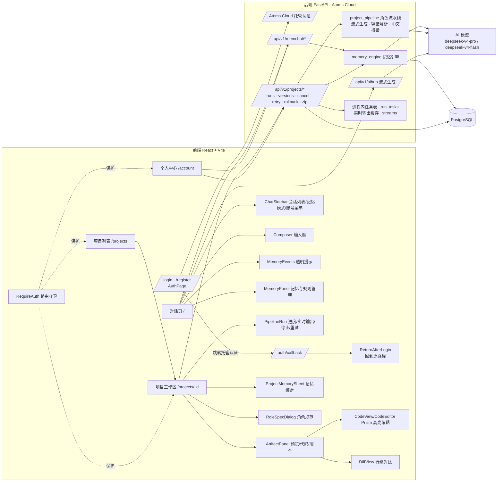

### 1.3 主要模块与模型

| 模块 | 代码位置 | 作用 | 使用模型 |
|---|---|---|---|
| 对话回复 | `routers/memchat.py` 的 `/prepare`，加前端流式调用 | 组装上下文并流式生成回复 | `deepseek-v4-pro` |
| 记忆引擎 | `services/memory_engine.py` | 规则 / 召回 / 抽取 / 写入 | 抽取用 `deepseek-v4-flash` |
| 项目主管 | `services/project_pipeline.py` 的 `run_lead` | 拆解任务、制定验收要点（非流式） | `deepseek-v4-pro` |
| 开发工程师 | `services/project_pipeline.py` 的 `run_developer` | 流式生成代码、容错解析、自测、修复一轮 | `deepseek-v4-pro` |
| 记忆沉淀 | `routers/project_workspace.py` 的 `_sediment_memories` | 把项目结论写入长期记忆 | `deepseek-v4-flash` |
| 认证 | Atoms Cloud 托管认证；前端 `AuthPage`、`RequireAuth`、`lib/authFlow.ts` | 登录、注册、退出、回到原路径 | — |
| 代码与版本 | 前端 `CodeView.tsx`、`DiffView.tsx`、`lib/diff.ts`；后端 `/versions`、`/rollback`、`/zip` | 高亮、编辑、对比、回滚、打包 | — |

所有 AI 调用都在后端经平台 AI 能力（AIHub）完成，前端不持有任何模型密钥。所有业务数据都按 `user_id` 隔离，每个接口都会校验数据归属。

### 1.4 项目接口清单（`/api/v1/projects`）

| 方法与路径 | 作用 |
|---|---|
| `GET /`、`POST /` | 列出项目、新建项目 |
| `GET /role-specs` | 角色 I/O 规范 |
| `GET/PUT/DELETE /{pid}` | 项目详情（含版本列表和项目对话）、修改、删除 |
| `GET/POST /{pid}/memories`、`DELETE /{pid}/memories/{mid}` | 记忆绑定 |
| `POST /{pid}/runs` | 发起 AI 迭代，可带 `base_run_id` 指定基线版本 |
| `GET /{pid}/runs/{rid}` | 版本详情，含实时输出 `stream`（最后 12000 字）和 `stream_length` |
| `GET /{pid}/runs/{rid}/html` | 版本的 HTML 内容 |
| `POST /{pid}/runs/{rid}/cancel` | 停止运行中的版本 |
| `POST /{pid}/runs/{rid}/retry` | 在原版本号上重跑失败的版本 |
| `POST /{pid}/runs/{rid}/rollback` | 把目标版本复制成新版本 |
| `POST /{pid}/versions` | 保存手动编辑，生成新版本，请求体为 `{files, base_run_id, note}` |
| `GET /{pid}/runs/{rid}/zip` | 打包下载，返回 `{filename, base64}` |

---

## 2. 对话模块

### 2.1 使用方式

1. 首页 `/` 未登录时显示落地页，提供“登录”“注册”两个按钮（见 4.8）。登录后，左侧是会话列表、“记忆模式”“记忆管理”入口、项目工作区入口和账号菜单（个人中心 / 退出登录）。
2. 在输入框发送消息。首页提供了几条示例提示，例如“记住：我是前端工程师，主要用 React 和 TypeScript”“你记得关于我的哪些信息？”。
3. 每轮对话的状态依次为：**正在检索记忆… → 已召回 N 条记忆，正在思考… → 流式输出 → 正在提炼记忆… → 完成**。
4. 助手消息下方会出现 **记忆事件条**，列出本轮召回、新建、更新、删除了哪些记忆，以及提示信息。
5. 刷新页面后，会自动打开上次所在的会话（见 4.9）。会话列表或消息加载失败时，显示错误提示和“重试”按钮。
6. 回复失败（例如 AI 余额不足）时，界面提示“回复失败：…，请重新发送”。用户消息已经保存，充值后重新发送即可（见 6.2）。

### 2.2 新建对话

- 点击侧边栏的“新建对话”，会清空当前会话。发送第一条消息时，后端会自动创建会话，标题取消息前 24 个字。
- 新对话**不会**带上旧会话的消息（会话层隔离），但**会**召回长期记忆，也会注入全局规则。这就是“新对话也会用上”的含义。
- 删除对话会连同其消息一起删除，**长期记忆不受影响**（界面提示“对话已删除（长期记忆不受影响）”）。窄屏下删除按钮常显，不依赖鼠标悬停。

### 2.3 单轮对话的处理流程

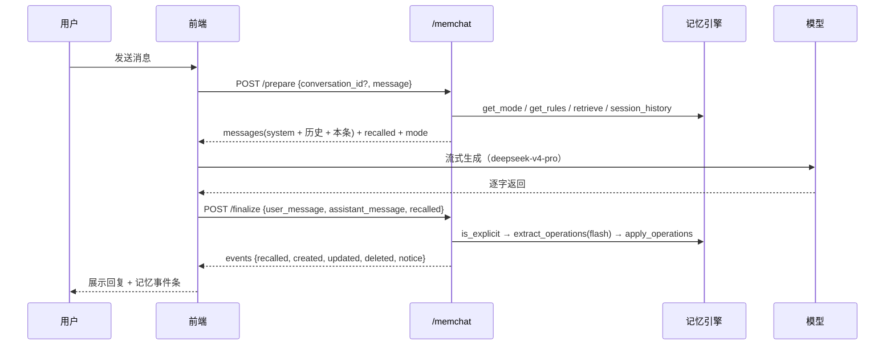

设计要点：回复环节和记忆写入环节**拆成两次请求**。回复走流式输出，首字延迟低；记忆抽取在回复结束后进行，抽取失败也不会影响已经给出的回复（失败时提示“记忆提取暂时失败，本轮未写入记忆”）。

---

## 3. 记忆系统（核心）

### 3.1 三层记忆与生命周期

| 层级 | 存储 | 由谁产生 | 作用范围 | 注入方式 | 生命周期 |
|---|---|---|---|---|---|
| **规则层**（Steering） | `memory_rules` | 用户在“记忆管理 → 规则”中手动添加 | 全局，所有对话和项目 | 每次都注入系统提示词，优先级最高（“必须遵守”） | 用户启用、停用或删除（删除为物理删除） |
| **会话层** | `chat_messages` | 对话自动产生 | 仅当前会话 | 取最近 **12 条**消息（`SESSION_WINDOW`）作为历史 | 随会话存在，删除会话即消失 |
| **长期记忆** | `memories` | 自动抽取、显式记住、手动新增、项目沉淀 | 跨会话、跨项目 | 按“常驻画像 + 相关度”召回后注入 | `active` → 更新 → `deleted`（软删除） |

**规则不受记忆模式影响**：即使记忆模式为“关闭”，启用状态的规则仍会注入。

### 3.2 记忆流水线：提取 → 写入 → 召回 → 注入

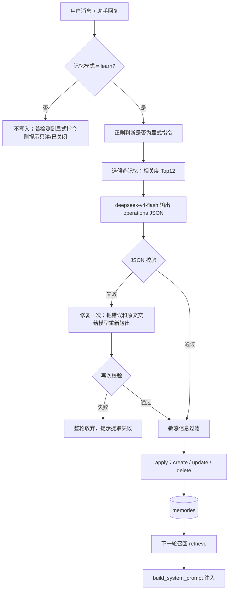

#### ① 触发方式

- **显式记忆**：用户消息命中正则 `记住|记一下|帮我记|请记|别忘了|忘掉|忘记|不要再记|删掉…记忆`，即视为显式指令。抽取模型会被告知“检测到显式记忆指令：是”，写入时置信度为 0.95，来源标记为 `explicit`。
- **隐式抽取**：在 learn 模式下，**每一轮对话结束后都会**调用抽取模型，由它判断是否有值得长期保存的信息。隐式写入的置信度为 0.7，来源标记为 `implicit`。模型也可以在单条操作上标记 `explicit:true`，此时按显式处理。

#### ② 过滤规则

抽取提示词（`EXTRACT_SYSTEM`）约定了哪些信息该存、哪些不该存：

- **适合存**：固定偏好、身份或职业背景、长期目标、软硬件环境、持续进行中的项目、重要约定、用户纠正过的做法。
- **不要存**：临时计算结果、单次问题、一次性查询、闲聊、实时信息、助手自己的观点，以及敏感隐私。

另有一道**代码层硬过滤**（`SENSITIVE_PATTERN`，基于正则）：create 或 update 时，如果内容包含 11 位以上的连续数字，或出现“密码 / 身份证 / 银行卡 / 验证码 / password”，该条操作会被直接丢弃。delete 操作不受影响。

此外，每轮**最多执行 3 条操作**；没有值得记的内容时输出空数组，界面提示“本轮没有值得长期保存的信息”。

#### ③ 召回（`retrieve`）

召回采用“**结构化过滤优先，相关度打分其次**”的两段式：

1. **常驻画像**：从 `active` 记忆中选出分类为“偏好 / 个人背景 / 约定”、且置信度 ≥ 0.8 的记忆，按置信度和更新时间排序，取前 **4** 条。这些记忆每轮都会注入，召回理由显示为“常驻画像”。
2. **相关度召回**：对其余记忆计算相关度并取前 **4** 条，阈值为 **0.12**，召回理由显示为“相关度 x.xx”。打分公式为：
   - `relevance = |Q ∩ M| / sqrt(|Q|·|M|)`，其中 Q、M 分别是查询文本和记忆文本（标题 + 场景 + 内容）的特征集合：中文取相邻两字（bigram），英文和数字取长度 ≥ 2 的词。这是**字面匹配**，不理解同义改写。
   - `score = relevance × (0.6 + 0.4 × confidence)`，置信度越高，排名越靠前。
3. 被召回的记忆 `hit_count + 1`，记忆管理界面会显示“召回 N 次”。

> 结果：隐式抽取（0.7）得到的偏好不会成为常驻画像，只有在话题相关时才会被召回；显式记住（0.95）或手动编辑（1.0）的偏好会每轮常驻。

#### ④ 注入（`build_system_prompt`）

系统提示词依次拼接以下内容：

1. 助手人设。
2. `## 用户规则（Steering，全局生效，必须遵守）`。
3. `## 关于用户的长期记忆（跨会话召回）`：每条记忆格式为 `[分类] 标题：内容（适用：场景）`，并要求模型“自然利用、不逐条复述、不编造”（mode=off 时不注入）。
4. 一句与模式对应的提示。例如 use 模式下，用户要求记住时，模型会告诉用户需要开启“自动学习”。

然后再拼接会话层最近 12 条消息，以及本轮用户消息。

### 3.3 记忆条目的数据结构与置信度

| 字段 | 说明 |
|---|---|
| `title` | 标题，抽取时要求不超过 12 字，存储时截断到 40 字 |
| `scene` | 适用场景（何时该用这条记忆），不超过 30 字，存储时截断到 120 字 |
| `content` | 提炼后的事实，用第三人称“用户……”，不超过 60 字，存储时截断到 300 字；**不复制原文** |
| `category` | `偏好 / 个人背景 / 项目信息 / 约定`，非法值归为“偏好” |
| `confidence` | 置信度（见下表） |
| `source` | `explicit / implicit / manual` |
| `source_session_id` | 来源对话 ID；项目沉淀产生的记忆为 0 |
| `status` | `active / deleted` |
| `hit_count` | 被召回的次数 |
| `create_time / update_time` | ISO 时间戳 |

| 来源 | 置信度 | 规则 |
|---|---|---|
| 手动新增或编辑 | **1.0** | 手动编辑会把置信度重置为 1.0，来源改为 `manual` |
| 显式记住 | **0.95** | |
| 隐式抽取 | **0.7** | |
| 更新已有记忆 | `max(原值, 新值)` | 置信度只升不降 |

### 3.4 去重、冲突更新与软删除

- **去重**：写入前，按相关度从现有 `active` 记忆中选出最多 12 条候选（总数不超过 12 条时全部作为候选），连同 `id` 一起交给抽取模型。模型判断为语义重复时输出 `skip`，代码直接忽略。
- **冲突更新**：新信息补充或推翻旧事实时，模型输出 `update` 并给出 `target_id`，以新信息为准覆盖。界面的事件条会展示更新前后的内容（`before`）。
- **遗忘**：用户说“忘掉 / 不要记 / 删掉…记忆”时，模型输出 `delete`，系统执行**软删除**：`status` 改为 `deleted`，数据保留，但不再参与召回和展示。
- **安全约束**：`target_id` 必须出现在本轮候选集合中，并且属于当前用户且处于 `active` 状态，否则该操作会被静默跳过，以防模型凭空引用 ID 误改其他记忆。
- 手动在记忆面板中删除，同样是软删除。

> ⚠️ 局限：去重和冲突判断完全依赖抽取模型的语义判断，没有基于规则的二次去重。候选只取相关度前 12 条，记忆很多时，相关度低的重复项可能漏判。

### 3.5 三档记忆模式

| 模式 | 界面名称 | 召回或注入 | 抽取或写入 | 显式指令时 |
|---|---|---|---|---|
| `off` | 关闭 | ✗ | ✗ | 提示“记忆已关闭，未写入” |
| `use` | 仅使用 | ✓ | ✗ | 提示“记忆为只读模式，未写入” |
| `learn` | 使用 + 自动学习（**默认**） | ✓ | ✓ | 正常写入 |

记忆模式按用户保存（`memory_settings`），在侧边栏切换，**对对话和项目同时生效**，个人中心也会显示当前模式：

- `off`：项目不读取绑定的记忆。
- `use`：项目读取绑定的记忆，但不沉淀新记忆。
- `learn`：项目读取绑定的记忆，并沉淀新记忆。

### 3.6 透明提示与记忆管理界面

- **透明提示（MemoryEvents）**：每条助手消息下方展示本轮的 召回 / 新建 / 更新 / 删除 及提示信息。这些事件会持久化到 `chat_messages.memory_events`，刷新或回看历史时仍然可见。
- **记忆管理面板（MemoryPanel）**：
  - **长期记忆**：支持搜索和按分类筛选。每条记忆显示标题、适用场景、置信度、来源（显式记住 / 自动抽取 / 手动编辑）、来源对话号、召回次数和更新时间，可以新增、编辑和删除。
  - **规则**：支持新增、编辑、启用 / 停用和删除。界面说明：“规则是你主动定义的全局约定（类似 Steering 规则），每次对话都会注入系统提示词，优先级最高。”

---

## 4. 项目板块（核心）

### 4.1 项目工作区与项目信息

- 在 `/projects` 新建项目时填写四项：**项目名称**（必填）、**项目目标**、**项目背景**（目标用户、场景、约束）、**验收标准**（怎样算完成）。这些信息会作为项目主管和开发工程师的**标准输入**。项目列表顶部有“继续上次的项目”入口，顶栏有个人中心入口。
- 工作区 `/projects/:id` 的布局为：左侧是“对话与流水线”，右侧是“预览 / 代码 / 版本”三个标签页。顶部可以编辑项目信息、管理项目记忆、查看角色规范。窄屏下左右两栏会改为上下堆叠，或通过切换按钮查看。
- 删除项目会删除它的所有版本、项目对话和记忆绑定，**已沉淀的长期记忆会保留在记忆库中**。

### 4.2 记忆绑定

- 在“项目记忆”抽屉中，可以从长期记忆库里选择记忆绑定到项目，绑定关系记为 `relation = bound`。项目主管和开发工程师都会读取这些记忆，格式为 `[分类] 标题：内容`。
- 项目迭代沉淀出的新记忆会自动绑定，`relation = derived`，界面标记为“项目沉淀”。
- 项目**不走相关度召回**，只使用显式绑定的记忆。这样项目上下文是确定、可控的。全局规则同样会注入两个角色。

### 4.3 角色分工

点击“角色规范”可以查看后端 `/api/v1/projects/role-specs` 返回的结构化 I/O 规范。

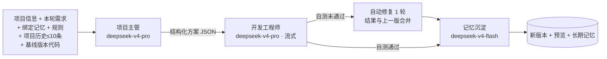

#### 项目主管（lead）

- **职责**：把目标拆解成可执行的任务，并给出交付物、可逐项检查的验收要点和风险。范围要克制：只做单页网页应用（HTML/CSS/原生 JS），不引入登录、支付、后端等能力。
- **输入**：`goal, background, acceptance, prompt, memory_context[], rules[], history[]（≤10）`，以及是否已有版本。
- **输出 schema**（后端 `validate_lead` 会强校验）：

| 字段 | 类型 | 约束 |
|---|---|---|
| `summary` | string | 非空，≤500 字 |
| `tasks` | `{id, title, detail, owner}[]` | 1–8 条；owner 固定为“开发工程师” |
| `deliverables` | string[] | ≤10 条 |
| `acceptance_points` | string[] | **2–8 条**，必须可观察、可验证 |
| `risks` | string[] | ≤6 条 |

- **容错**：首次输出校验失败时，把错误和原文交给模型修复一次（temperature 0）；修复后仍失败，则该轮流水线失败。

#### 开发工程师（dev）

- **职责**：严格按照主管方案生成能在浏览器直接运行的单页应用，最多 3 个文件：`index.html`（必须）、`styles.css`、`app.js`。数据用 localStorage 或内存保存，禁止空按钮、假成功和 TODO；**index.html 引用的每个本地文件都必须输出**；然后完成自测。
- **输入**：`lead_output, goal/prompt, memory_context[], rules[]`；迭代时还有 `previous_files`，即基线版本的完整代码，在它的基础上修改。
- **输出格式**：用 `<file path="...">原文</file>` 块输出代码，用一个 `<meta>{JSON}</meta>` 块输出说明。代码不放进 JSON 字符串，是为了避免长代码的转义问题。解析容错见 4.4.4。
- **输出 schema**：

| 字段 | 说明 |
|---|---|
| `files` | 路径 → 内容，必须包含 `index.html`；含 `..` 或绝对路径的文件路径会被拒绝 |
| `stack` | 技术栈说明 |
| `delivery_log` | 交付记录（≤12 条） |
| `self_check` | `{passed, items:[{point, passed, evidence, kind}], notes}`；`kind` 为 `acceptance` 或 `static`；`notes` 还会记录自动补齐文件、修复轮合并等情况 |
| `fix_round` | 0 或 1 |
| `kind` | 固定为 `pipeline`，用来和手动编辑、回滚版本区分（见 5） |

- **自测 = 验收自检 + 静态检查**：
  1. **验收自检**（kind=acceptance）：模型逐条对照主管的验收要点给出 passed 和 evidence。漏掉的要点由代码自动补为“开发自测未覆盖该验收要点”，判为不通过。缺少 `<meta>` 块时，沿用上一轮的 meta。
  2. **静态检查**（kind=static，代码确定性执行）：
     - index.html 中 html/body 标签完整；
     - 本地引用的 CSS/JS 文件全部存在；
     - 没有 TODO / FIXME / 待实现 / lorem ipsum；
     - JS 去掉字符串和注释后，括号配对完整（用于发现输出被截断）。
  3. `passed = 所有检查项都通过`。
- **容错与修复**：
  - **格式重试**：首次输出无法解析（解析后仍没有任何文件，或缺少 index.html）时，提示模型严格按格式输出并精简代码，重新生成一次。
  - **自动修复一轮**：自测未通过时进入 `fix` 阶段，把未通过的检查项和当前文件交给模型修复。修复轮**只需输出改动过的文件**，结果会与修复前的文件合并，修复后重新自测。**最多 1 轮**；修复后即使仍有未通过项，也会交付并标记“自测未通过”。
  - 修复轮输出仍无法解析时，保留修复前的结果，并在 notes 中记录“自动修复一轮失败”，不会让整轮失败。

#### 记忆沉淀（memory）

- **职责**：把本轮的项目结论提炼进长期记忆，并绑定回项目。
- **输入**：`[项目「名称」] 本轮需求`，以及一段结论文本：`项目「名称」vN 迭代结论：{summary}。技术栈：…。交付：{delivery_log 前 5 条}`。其中 vN 是界面上的版本号。
- **处理**：复用对话中的同一套记忆引擎，包括候选去重、`deepseek-v4-flash` 抽取、敏感过滤和 create/update/delete。新建或更新的记忆以 `derived` 关系绑定到项目。
- **条件**：只在 learn 模式下执行，其他模式会提示“记忆模式非‘自动学习’，本轮未沉淀项目记忆”。沉淀失败不影响版本交付（提示“项目记忆沉淀暂时失败”）。手动编辑和回滚生成的版本不触发沉淀。

### 4.4 流水线状态机与 Agent 交互

#### 4.4.1 使用方法

1. 在工作区左下输入框写需求，点击发送，发起一轮迭代。输入框左下角可以选择**基线版本**：默认是最近一个可用版本，也可以改选任意历史版本，表示“在该版本上追加需求”。
2. 流水线卡片依次点亮“项目主管 → 开发工程师 → 自动修复 → 记忆沉淀”。开发阶段展开**实时输出**终端，显示模型正在写的代码，并提示“正在写入某个文件”。
3. 运行中可以点击 **停止**。停止后该版本标记为失败，原因是“已手动停止，可点击‘重试’重新运行”。
4. 失败的版本会显示中文原因和 **重试** 按钮；如果是余额不足，还会多一个“去充值 AI 余额”链接。重试会在原版本号上重新运行。
5. 完成后右侧自动切换到该版本的预览。

#### 4.4.2 状态机

每次 AI 迭代都会创建一条 `project_runs` 记录，版本号为当前最大版本号 + 1。流水线在后端以异步后台任务执行，前端每 1.5 秒轮询版本详情来展示进度。

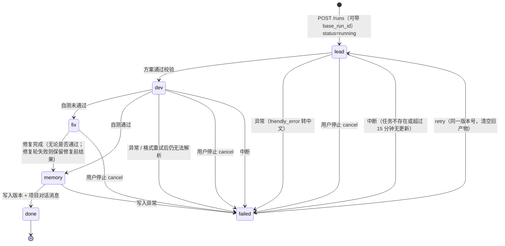

- `status`：`running / done / failed`；`stage`：`lead / dev / fix / memory / done / failed`。
- 同一项目同时只允许一条流水线在运行，重复发起会返回 409“上一轮流水线仍在执行，请稍候”。
- **中断判定**：后端用进程内字典 `_run_tasks` 登记每个运行对应的 asyncio 任务。读取项目或版本时，如果某个 running 版本对应的任务已经不存在或已结束（例如服务重启），或超过 **15 分钟**（`STALE_AFTER`）没有更新，就把它标记为失败：“执行中断（服务重启或任务丢失），可点击‘重试’重新运行”。**不会自动续跑**，只能手动重试。
- **停止**：`POST /runs/{id}/cancel` 会取消后台任务，并把版本标记为失败（“已手动停止”）。如果任务恰好在写入阶段被停止，`_update_run` 会发现状态已经不是 running，随即抛出取消异常、中止后续写入，不会覆盖“已停止”的状态。
- **重试**：`POST /runs/{id}/retry` 只能用于 failed 状态的版本。重试会在**原版本号**上清空旧产物、用相同需求重新运行，基线代码取该版本之前最近一个成功版本。这样运行 ID 和版本号保持一一对应，不会因为重试多出版本。
- **基线版本**：`POST /runs` 带 `base_run_id` 时，以该版本的文件作为 `previous_files`，需求前加上“（基于 vN 继续迭代）”；不带时，使用最近一个 done 状态的版本。
- 完成后，主管方案和开发自测报告会合并成一条项目对话消息（Markdown），存入 `project_messages`，作为后续迭代的历史输入。

#### 4.4.3 实时流式输出

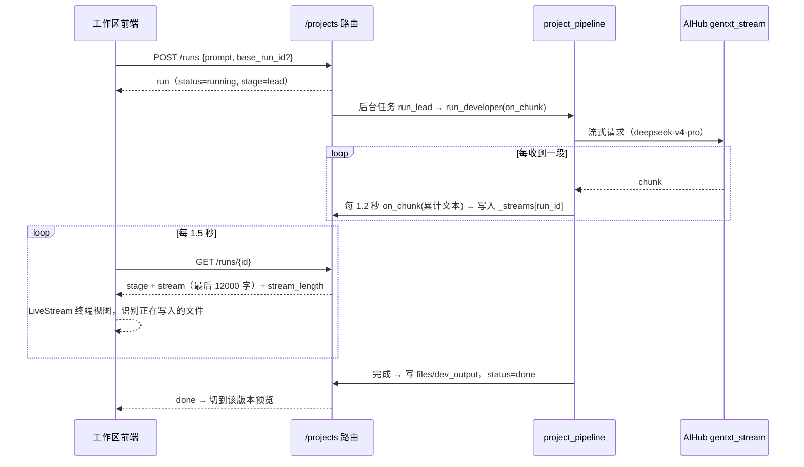

- 只有开发阶段（含修复轮）是流式的，项目主管阶段返回完整 JSON。
- 实时输出只保存在**服务进程内存**（`_streams`），刷新页面后仍可继续显示；服务重启后会丢失，不写入数据库。

#### 4.4.4 开发输出容错解析

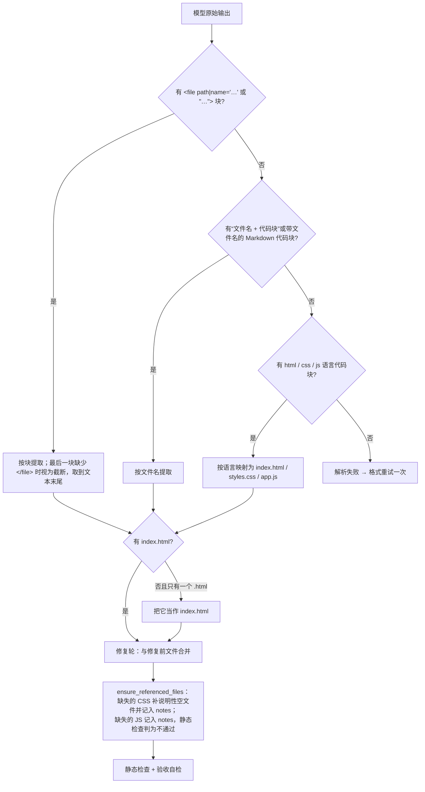

- 这一流程解决了实测中出现的问题：修复轮报“no <file> blocks found”；index.html 引用了 `styles.css`，但没有生成这个文件。

#### 4.4.5 中文报错

`friendly_error` 把异常转换为可操作的中文提示，前端失败卡片 `FailureBox` 原样展示，并附上“重试”按钮：

| 异常特征 | 提示 |
|---|---|
| `insufficient_ai_balance`，或 403 且包含 balance | AI 余额不足（insufficient_ai_balance）：请先在 Atoms 设置中充值 AI 余额，然后点击“重试”。前端额外提供“去充值 AI 余额”链接 |
| timeout / timed out | AI 服务响应超时，请稍后点击“重试”。 |
| no <file> blocks / index.html is required | 开发工程师的输出无法解析为代码文件（格式偏差或被截断），请点击“重试”或精简需求。 |
| 429 / rate limit | AI 服务请求过于频繁，请稍后点击“重试”。 |
| 其他 | 执行出错：{原始信息前 300 字} |

> 模型配置没有因为余额问题而更换：项目主管和开发工程师使用 deepseek-v4-pro，记忆抽取和沉淀使用 deepseek-v4-flash。

### 4.5 产物预览

#### 4.5.1 使用方法

- 右侧“预览”标签页显示当前选中版本。工具栏提供 **桌面（100%）/ 平板（820px）/ 手机（390px）** 三种尺寸、**刷新**，以及 **在新标签页打开**。
- 底部状态栏显示“暂无报错”或“捕获 N 个报错”，可以展开查看。点击 **交给开发修复**，会以当前版本为基线发起新一轮迭代，需求为“修复 vN 预览中出现的运行时报错，保持现有功能不变”，并附上报错（最多 10 条）。

#### 4.5.2 设计逻辑

- **多文件合并**：前端 `bundleHtml` 会把 index.html 中引用的本地 CSS/JS（支持 `./` 前缀、单双引号、`?v=` 查询参数、`type="module"`）替换为内联的 `<style>` / `<script>`，再通过 iframe `srcdoc` 渲染。iframe 的 sandbox 不开启 `allow-same-origin`，生成的代码无法访问主应用的 Cookie 和存储。
- **预览运行时**：合并后的页面开头会注入 `PREVIEW_RUNTIME` 脚本，负责两件事：一是把 `error`、`unhandledrejection`、`console.error` 和资源加载失败通过 `postMessage` 上报给父页面；二是在沙箱禁用 localStorage/sessionStorage 时提供内存版替代，避免生成的应用因此报错。
- **刷新**：重新生成 iframe 的 key，同时清空已收集的报错。
- **在新标签页打开**：用合并后的完整 HTML 生成 Blob URL 并打开。

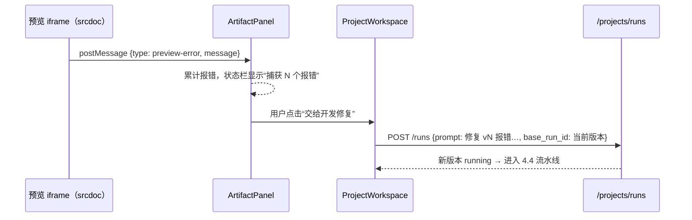

### 4.6 项目记忆如何回流长期记忆

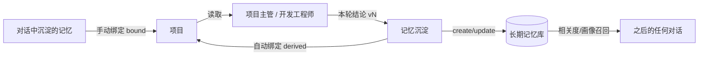

项目沉淀出的记忆就是普通的长期记忆（通常分类为“项目信息”），在之后的对话中，只要话题相关就会被召回。比如在新对话中问“我的番茄钟项目做到哪了”，可以召回该项目的结论。项目被删除后，这些记忆仍然保留。

### 4.7 代码管理

#### 4.7.1 使用方法

1. **查看代码**：在“代码”标签页左侧的文件树中点选文件，右侧显示带行号的语法高亮代码，可以复制。窄屏下文件树会收起成下拉框。
2. **在线编辑**：点击“编辑”进入编辑模式，修改后，有改动的文件旁会出现橙色圆点。点击 **保存为新版本** 生成一个新版本（类型“手动编辑”），点击“取消”放弃修改。
3. **版本对比**：在“版本”标签页点击某个版本的“对比”，或在对比视图中选择两个版本，查看每个文件的增删行数和行级差异；可以交换两个版本。
4. **回滚**：在版本卡片上点击“回滚到此版本”，确认后生成一个新版本（类型“回滚”），内容与目标版本相同。
5. **zip 下载**：点击版本卡片上的“下载 zip”，得到 `项目名-vN.zip`。

#### 4.7.2 设计逻辑

- **语法高亮**：`CodeView` 使用 Prism（`prismjs@1.29.0`），根据扩展名选择 markup / css / javascript 语法，主题样式在 `code-theme.css` 中定义。
- **编辑器**：`CodeEditor` 用一个透明的 textarea 叠在高亮层上，两层同步滚动，支持 Tab 缩进。这样不需要引入重量级编辑器依赖。
- **保存规则**：`POST /projects/{id}/versions` 的请求体为 `{files, base_run_id, note}`，后端会校验：
  - 文件数在 1–**20** 个之间；
  - 路径合法，不能含 `..`，也不能是绝对路径；
  - 每个文件不超过 **300KB**；
  - 必须包含 `index.html`。
  校验通过后写入一条新的 `project_runs`，`dev_output.kind = manual`，并记录 `source_version`。手动版本**只做静态检查**，不调用 AI，也不沉淀记忆。
- **版本对比**：`lib/diff.ts` 实现逐行 LCS 差异算法；`DiffView` 显示每个文件的新增、删除行数以及总计，未变化的连续行会折叠，前后各保留 3 行上下文。
- **回滚**：`POST /runs/{id}/rollback` 把目标版本的文件复制为新版本，`dev_output.kind = rollback`。原有历史全部保留，后续 AI 迭代默认以这个新版本为基线。
- **zip 下载**：`GET /runs/{id}/zip` 在后端用 zipfile 打包，返回 `{filename, base64}`；前端解码为 Blob 后触发下载。

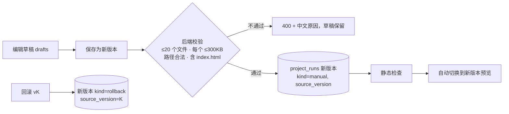

### 4.8 注册登录

#### 4.8.1 使用方法

- **登录 / 注册**：首页落地页或任意受保护页面都会引导到 `/login` 或 `/register`。页面左侧是品牌介绍，右侧是说明和按钮。点击“使用邮箱登录 / 注册”后跳转到 **Atoms Cloud 托管认证页**，在那里填写邮箱和密码；表单校验（邮箱格式、密码规则）和错误提示也由托管页负责。登录页和注册页之间可以互相切换。
- **回到原页面**：直接访问 `/projects`、`/projects/:id` 或 `/account` 时，如果未登录，会被带到 `/login?redirect=原路径`；登录成功后自动回到原来的页面，包括查询参数（例如 `?v=3&tab=code`）。
- **个人中心 `/account`**：显示头像、邮箱、角色、最近登录时间和用户 ID，统计对话、项目、长期记忆、规则的数量以及当前记忆模式。侧边栏账号菜单和项目页顶栏都有入口。
- **退出登录**：在个人中心或侧边栏菜单中点击“退出登录”，二次确认后调用 SDK 的 `logout()`，回到首页。

#### 4.8.2 设计逻辑

- 认证完全复用 Atoms Cloud（SDK 提供 `login / logout / me`），本应用**不保存密码，也没有另建一套账号体系**。所有后端接口用 `get_current_user` 校验身份，数据按 `user_id` 隔离。
- 托管认证的回调固定落在 `/auth/callback`，之后进入首页，无法直接携带业务路径。因此登录前由 `rememberReturn()` 把原路径写入 sessionStorage，登录后由 `ReturnAfterLogin` 调用 `takeReturn()` 读取并跳转（只接受站内相对路径）。

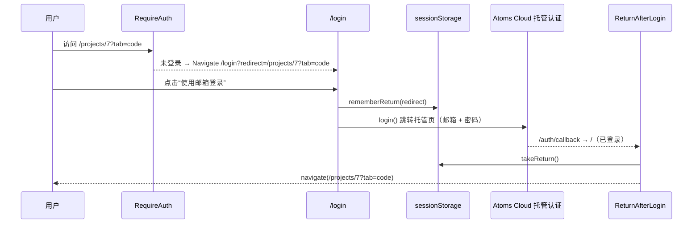

### 4.9 数据持久化与状态恢复

#### 4.9.1 使用方法

- 对话页刷新后，自动打开上次所在的会话。
- 项目工作区刷新后，停留在原来的版本和标签页，输入框里未发送的草稿仍在；如果有正在运行的流水线，进度和实时输出会继续显示。
- 项目列表提供“继续上次的项目”入口。
- 因服务重启等原因中断的流水线，会显示为失败，并提供“重试”按钮。

#### 4.9.2 设计逻辑

| 恢复对象 | 存放位置 | 键 / 机制 |
|---|---|---|
| 上次会话 | localStorage | `atoms:lastConversation`，会话被删除或不存在时清除 |
| 上次项目 | localStorage | `atoms:lastProject`，记录 `{id, name}`，项目不存在时清除 |
| 当前版本与标签页 | URL | `/projects/:id?v=版本号&tab=preview|code|versions` |
| 输入框草稿 | sessionStorage | 按项目区分的草稿键，发送后清除 |
| 登录后回跳 | sessionStorage | 见 4.8 |
| 流水线进度 | 数据库 `project_runs` + 前端轮询 | 每 **1.5 秒**轮询一次，有 running 版本时持续进行 |
| 实时输出 | 服务进程内存 `_streams` | 不持久化 |
| 版本数据 | 数据库 `project_runs` | 每个阶段都会写入 stage 和 update_time |

- **版本号与运行 ID 的对应关系**：一个版本就是一条 `project_runs` 记录，界面和记忆沉淀统一用版本号 vN。重试复用原记录和原版本号，因此不会出现“一个版本对应多条运行记录”的情况。
- **可靠保存**：每个阶段结束时立即提交数据库；手动编辑在服务端校验通过后才写入；对话消息先保存用户消息再生成回复，回复失败不会丢失用户输入。

### 4.10 界面状态与窄屏适配

- **统一风格**：新增的登录、注册、个人中心、代码、版本、对比页面都沿用 Atoms 风格的设计变量（深色品牌面板、圆角卡片、统一的主色和字体）。
- **三种状态**：会话列表、消息列表、项目列表、项目工作区、版本列表和个人中心，都有加载中（骨架屏或加载动画）、空数据（说明和下一步操作）、出错（错误信息和“重试”按钮）三种状态。
- **窄屏适配**：
  - 侧边栏改为抽屉；
  - 工作区左右两栏改为可切换；
  - 文件树改为下拉框；
  - 预览尺寸按钮只显示图标；
  - 删除等操作在触屏设备上常显。

---

## 5. 数据模型

所有表都有 `user_id` 字段（按用户隔离）和 `id` 自增主键。本轮没有新增表或字段（原因见 8）。

| 表 | 用途 | 关键字段 |
|---|---|---|
| `conversations` | 对话会话 | title, last_active |
| `chat_messages` | 会话消息（会话层） | conversation_id, role, content, memory_events(JSON) |
| `memories` | 长期记忆 | title, scene, content, category, confidence, source, source_session_id, status, hit_count |
| `memory_rules` | 规则层 | content, enabled |
| `memory_settings` | 记忆模式 | mode (off/use/learn) |
| `projects` | 项目信息 | name, goal, background, acceptance |
| `project_memory_links` | 项目与记忆的多对多绑定 | project_id, memory_id, relation (bound/derived) |
| `project_runs` | 版本（一次 AI 运行、一次手动编辑或一次回滚） | version, prompt, status, stage, lead_output, dev_output, files, fix_rounds, memory_events, error, update_time |
| `project_messages` | 项目内对话 | project_id, run_id, role, content |

**`project_runs.dev_output` 的版本类型**：

| `kind` | 来源 | lead_output | 自测 | 记忆沉淀 | 额外字段 |
|---|---|---|---|---|---|
| `pipeline` | AI 流水线 | 有 | 验收自检 + 静态检查 | learn 模式下执行 | `fix_round`、`notes` |
| `manual` | 手动编辑保存 | 无 | 仅静态检查 | 不执行 | `source_version`，备注写在 prompt 中 |
| `rollback` | 回滚 | 无 | 仅静态检查 | 不执行 | `source_version` |

历史版本的 `dev_output` 没有 `kind` 字段，前端按 `pipeline` 处理。

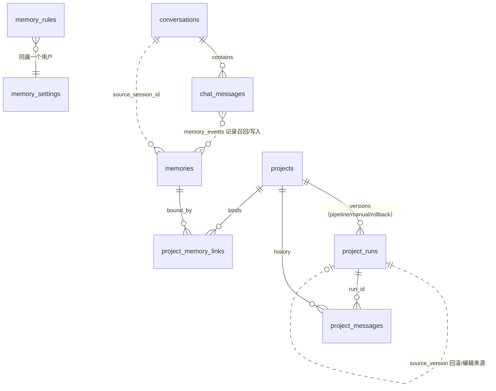

> 说明：`project_runs.qa_output` 和 `qa_first_output` 是早期“质量角色”留下的字段，当前流水线已经去掉这个角色，这两个字段不再写入。

---

## 6. 使用指南与常见问题

### 6.1 从零开始的体验路径

1. **注册 / 登录**：首页点击“注册”或“登录”，在 Atoms Cloud 认证页用邮箱和密码完成认证，之后自动回到应用。
2. **建立画像**：发送“记住：我是前端工程师，主要用 React 和 TypeScript”，事件条会显示“新建”。
3. **添加规则**：打开“记忆管理 → 规则”，添加“回答先给结论，再分点说明”。
4. **验证跨会话**：新建一个对话，问“你记得关于我的哪些信息？”。事件条会显示召回的记忆，回复也会遵守规则。
5. **体验更新与遗忘**：说“我现在改用 Vue 了”，事件条会显示“更新”；说“忘掉我的技术栈”，事件条会显示“删除”。
6. **新建项目**：进入项目工作区，新建“番茄专注计时器”，填写目标和验收标准。
7. **绑定记忆**：在“项目记忆”中勾选相关记忆。
8. **开始构建**：观察流水线依次经过 项目主管 → 开发工程师（实时输出、自测、修复）→ 记忆沉淀，完成后右侧出现预览。觉得方向不对可以随时点“停止”。
9. **检查预览**：切换桌面、平板、手机尺寸，在新标签页打开；如果状态栏捕获到报错，点击“交给开发修复”。
10. **继续迭代**：选择基线版本后，输入“增加深色模式，统计数据用图表展示”，生成新版本。
11. **管理代码**：在“代码”中直接修改文案并“保存为新版本”；在“版本”中对比两个版本，必要时回滚或下载 zip。
12. **刷新验证**：刷新页面，确认仍停留在原版本和标签页，草稿还在。
13. **回到对话**：在记忆管理中可以看到“项目沉淀”的记忆，相关话题会召回它们。
14. **个人中心**：从账号菜单进入 `/account`，查看使用统计，或退出登录。

### 6.2 常见问题

**Q：提示“AI balance is insufficient… Please go to the settings to top up”或“AI 余额不足”，是我的应用设置有问题吗？**
不是应用配置的问题。应用里所有 AI 调用（对话回复、记忆抽取、项目主管、开发工程师、记忆沉淀）消耗的都是 **Atoms 账户的 Cloud & AI 钱包余额**。它和套餐积分（credits）**分开计算**：套餐积分还有，不代表 AI 余额充足。余额不足时，平台返回 403 `insufficient_ai_balance`，需要先在 Atoms 设置的 Cloud & AI 余额页面充值（应用里的“去充值 AI 余额”链接会直接打开该页面）。充值后的处理：
- **对话**：界面提示“回复失败：…，请重新发送”，用户消息已经保存，充值后重新发送即可。
- **记忆抽取**：提示“记忆提取暂时失败，本轮未写入记忆”，不影响对话。
- **项目**：版本进入失败状态，显示中文原因，充值后在失败卡片上点“重试”，会在原版本号上重新运行。

本应用**不会**为了绕开余额问题而切换模型。

**Q：为什么我说的话没被记住？**
可以依次排查：
1. 记忆模式是否为“使用 + 自动学习”。“仅使用”和“关闭”模式不会写入。
2. 内容是否属于不该存的类别，如单次问题、闲聊、实时信息。
3. 是否包含敏感信息，如 11 位以上数字、密码、身份证、银行卡、验证码，这类内容会被硬过滤。
4. 是否和已有记忆语义重复，重复时会被 skip。
5. 抽取是否失败，事件条会提示。

需要确定写入时，可以使用“记住：…”句式，或在记忆面板中手动新增。

**Q：记忆存了，但新对话没用上？**
隐式抽取的记忆置信度为 0.7，达不到常驻画像的门槛（0.8），只有和当前问题的**字面**相关度达到 0.12 时才会被召回，换个说法（同义词）可能召不回。重要的偏好建议显式记住，或手动编辑一次（编辑后置信度变为 1.0）。另外，“项目信息”分类不属于常驻画像。

**Q：自测未通过的版本还能用吗？**
能。版本照常交付并可以预览，只是标记为“自测未通过”。可以查看自测报告中的 ❌ 项，再发起一轮迭代来修复，也可以直接在“代码”中手动修改。

**Q：构建一直卡在某个阶段，或者刷新后显示“执行中断”？**
单轮开发通常需要 1–3 分钟，开发阶段可以在实时输出中看到进展。如果服务重启，或超过 15 分钟没有更新，该版本会被标记为“执行中断”。任务不会自动继续，点击“重试”即可在原版本号上重新运行。

**Q：停止之后还能继续吗？**
停止后版本处于失败状态，可以点击“重试”从头重跑这一轮；也可以选择之前的成功版本作为基线，发起新的需求。

**Q：手动保存时提示失败？**
检查是否满足以下条件：文件数不超过 20 个，每个文件不超过 300KB，包含 index.html，路径中没有 `..`。保存失败时草稿会保留。

**Q：回滚会删除后面的版本吗？**
不会。回滚是把目标版本复制成一个新版本，所有历史版本都保留。

**Q：注册时邮箱格式或密码规则的提示在哪里？**
在 Atoms Cloud 托管认证页上，由认证页负责校验和提示，本应用不接触密码。

---

## 7. 设计取舍与扩展方向

### 7.1 关键取舍

| 取舍 | 当前选择 | 原因 |
|---|---|---|
| 记忆检索 | 中文 bigram + 词重叠的余弦式打分 + 置信度加权，不使用向量库 | 无额外依赖，结果可解释（界面显示相关度分数），适合小规模个人记忆 |
| 记忆写入 | 由 LLM 决定 create/update/delete，代码负责校验和安全约束 | 语义去重和冲突判断交给模型，ID 范围、敏感过滤、数量上限由代码兜底 |
| 回复与记忆解耦 | prepare / 流式回复 / finalize 三段 | 记忆抽取不会拖慢首字，也不会让回复失败 |
| 项目记忆 | 只用显式绑定，不自动召回 | 项目上下文确定、可控、可审计 |
| 开发输出格式 | `<file>` 块 + `<meta>` JSON，配合多级容错解析 | 避免长代码在 JSON 中的转义问题；容错解析应对模型格式偏差和截断 |
| 自动修复 | 最多 1 轮，只输出改动的文件并合并 | 控制耗时和成本，避免修复轮漏掉未改动的文件 |
| 实时输出 | 流式生成 + 进程内缓存 + 1.5 秒轮询 | 不引入 WebSocket 或 SSE 长连接，刷新后可以续看；代价是不跨进程、不持久化 |
| 版本存储 | AI、手动、回滚统一存在 `project_runs`，用 `dev_output.kind` 区分 | 不新增表，版本号连续、全局唯一 |
| 认证 | 复用 Atoms Cloud 托管认证 | 不自建账号和密码体系，降低安全风险 |
| 代码编辑器 | Prism + textarea 叠加 | 体积小，满足单页应用的编辑需求 |
| 产物形态 | 单页 HTML/CSS/JS，合并后用 iframe srcdoc 预览 | 无需构建，可以即时、安全地预览 |

### 7.2 可扩展方向

1. **向量检索**：为 `memories` 增加 embedding 字段，采用“结构化过滤 + 向量相似度 + 关键词”的混合召回，解决同义不同字时召不回的问题。
2. **冲突时询问用户**：update 覆盖旧事实前，先在事件条中让用户确认“采用新信息 / 保留旧信息 / 两者都保留”。
3. **质量角色（QA）**：用户已经去掉了这个角色，但 `project_runs.qa_output / qa_first_output` 字段还在，可以作为扩展点重新加入独立验收角色，例如用无头浏览器真实操作页面。
4. **记忆衰减与归档**：结合 `hit_count` 和更新时间做衰减，长期未命中的低置信度记忆自动降级。
5. **项目自动召回**：在显式绑定之外，按项目目标做相关度推荐，由用户一键绑定。
6. **持久化任务队列**：把进程内的后台任务和实时输出缓存改为持久化队列和存储，服务重启后可以续跑。
7. **推送替代轮询**：改用 SSE 推送阶段变化和实时输出，降低延迟和请求量。
8. **多文件 / 框架产物**：放宽 3 个文件的限制，支持组件化项目和构建预览。
9. **独立版本表**：后端建表能力恢复后，把手动和回滚版本的元数据（kind、source_version、note）迁移为独立列。

---

## 8. 已知局限与未验证汇总

### 8.1 已修复

| # | 原问题 | 修复方式 | 验证情况 |
|---|---|---|---|
| F1 | 修复轮输出无法解析，报“no <file> blocks found” | 多级容错解析；修复轮只需输出改动的文件，并与原文件合并；解析失败时保留修复前的结果 | 用样例文本做了单元验证，真实模型输出未复测（受 AI 余额阻塞） |
| F2 | index.html 引用了 `styles.css`，但没有生成这个文件 | 提示词要求输出所有被引用的文件；缺失的 CSS 自动补齐，缺失的 JS 如实报告 | 用样例文本做了单元验证 |
| F3 | 模型漏掉 `<meta>` 块后，验收自检全部判为“未覆盖” | 修复轮缺少 meta 时沿用上一轮的 meta | 代码已实现，未用真实模型复测 |
| F4 | 记忆沉淀结论里用的是 run ID，与界面版本号不一致 | 统一改为 vN；重试复用原版本号 | 代码已实现 |
| F5 | 服务重启后版本一直显示 running | 任务不存在或超过 15 分钟无更新时，标记为“执行中断”，可以重试 | 代码已实现 |
| F6 | 报错只显示英文原文，没有重试入口 | `friendly_error` 转为中文提示，并提供“重试”和“去充值 AI 余额”入口 | 余额不足的转换已做单元验证 |
| F7 | 没有独立的登录 / 注册页，受保护页面登录后不能回到原路径 | 新增 `/login`、`/register`、`/account`，`RequireAuth` 加上 redirect 回跳 | lint、build 通过；页面渲染和真实登录未实测 |

### 8.2 现存局限

| # | 内容 |
|---|---|
| L1 | 后台任务和实时输出缓存都在服务进程内。服务重启后任务会被标记为失败，**不会自动续跑**；实时输出不持久化，重启后丢失 |
| L2 | 记忆召回基于字面 bigram 相关度，对同义改写不敏感 |
| L3 | 去重和冲突判断依赖模型；候选只取相关度前 12 条，记忆很多时可能漏判 |
| L4 | 敏感信息过滤是正则硬规则，可能误杀（如长数字 ID），也可能漏检其他形式的隐私 |
| L5 | 后端建表工具不可用（workspace 配置报错），因此没有新增数据表或字段：手动和回滚版本复用 `project_runs`，通过 `dev_output.kind` 区分 |
| L6 | 邮箱和密码的表单校验与错误提示由 Atoms Cloud 托管页负责，应用内无法自定义 |
| L7 | 产物限定为最多 3 个文件的单页 HTML/CSS/JS；手动保存最多 20 个文件、每个不超过 300KB |
| L8 | 进度靠 1.5 秒轮询，不是服务端推送；开发阶段的实时输出约有 1.2–2.7 秒延迟 |
| L9 | 所有 AI 功能依赖 Cloud & AI 钱包余额，余额不足时对话、抽取、流水线都会失败（应用会给出中文提示和重试入口） |

### 8.3 未验证

| # | 内容 | 原因 |
|---|---|---|
| U1 | 登录后的浏览器全流程：登录/注册页的实际渲染、托管认证往返、redirect 回到原路径、个人中心、退出登录 | 沙箱内无法完成托管登录；目前只检查过未登录首页的渲染 |
| U2 | 开发阶段的实时流式输出、停止、重试的端到端运行 | AI 余额不足（403 insufficient_ai_balance） |
| U3 | 修复轮合并与容错解析在真实模型输出上的表现 | 同上，只用样例文本做了单元验证 |
| U4 | 预览报错“交给开发修复”的完整闭环 | 依赖 AI 流水线，受余额阻塞；报错收集部分只做了代码层面的检查 |
| U5 | “自测通过”路径和多版本 AI 迭代路径 | 之前实测中 v1 跑完了全部阶段但自测未通过，v2 遇到余额不足 |
| U6 | 代码编辑保存、版本对比、回滚、zip 下载的浏览器操作 | 需要登录且需要已有版本；接口和前端已通过 lint、build 和后端语法检查，未在浏览器中实测 |
